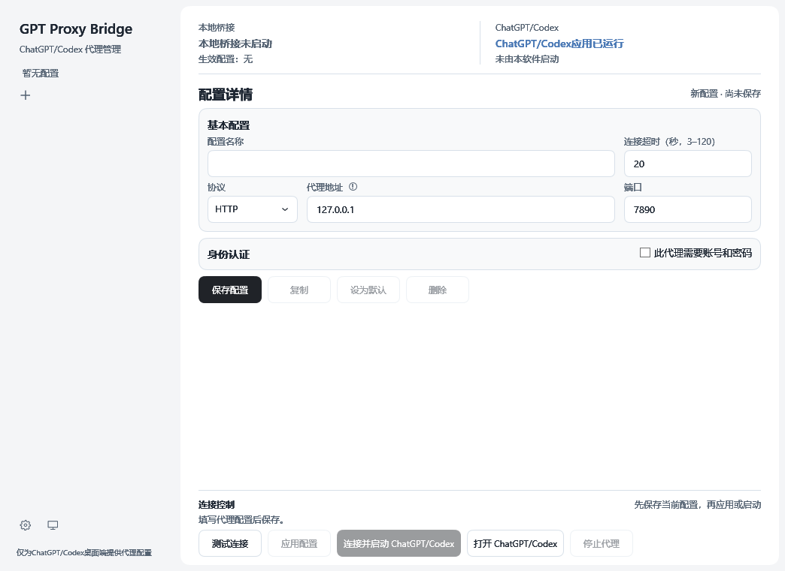

# GPT Proxy Bridge

Windows 桌面代理配置管理器，为 ChatGPT/Codex 桌面端管理上游代理，并通过本地桥接启动应用。

> 独立第三方工具，与 OpenAI 无隶属或官方认可关系。当前自动发现针对 `OpenAI.Codex` Windows 安装包，其程序名称可能显示为 ChatGPT。未验证其他独立 ChatGPT 安装包的兼容性。
>
> 代码使用 MIT 许可证；本项目由社区独立维护，不提供代理节点。

## 界面预览



浅色主题，使用独立空配置生成；图中仅显示程序默认值，不含个人代理配置、账号或密码。

## 适合什么场景

- 已有代理，希望仅为 ChatGPT/Codex 桌面应用配置代理，而不修改 Windows 系统代理。
- 可使用本机代理、局域网代理服务器、远程公网代理或带账号密码的代理。
- 保存家中、公司等多个代理配置，手动切换新连接使用的上游。
- 希望从可视化界面测试代理、启动或重新打开目标桌面应用。

**需要自行准备可用的代理服务器。** 本工具不提供节点、账号、订阅或网络服务，不是 VPN，也不会改变服务账号权限。

## 工作方式

```text
ChatGPT/Codex 中遵循代理设置的请求
             ↓
本机 HTTP 桥接：127.0.0.1:7995
             ↓
选定的 HTTP / HTTPS / SOCKS5 上游代理
             ↓
目标服务
```

通过启动参数和环境变量设置代理，不解密目标 HTTPS。绕过列表中的请求可直连；自行忽略代理的工具或独立服务不在强制控制范围内。这里的“设置”是程序共用设置，不是系统全局代理。

## 功能

| 功能 | 当前行为 |
| --- | --- |
| 上游协议 | HTTP、HTTPS、SOCKS5 |
| 地址 | 本机、局域网、公网 IP、域名、IPv6 |
| 认证 | HTTP/HTTPS 无认证或 Basic；SOCKS5 无认证或用户名密码 |
| 配置管理 | 新增、保存、复制、删除、设为默认、多配置切换 |
| 切换 | 先测试；成功后新连接使用新配置，已有连接保留原配置直到结束 |
| 应用控制 | 连接并启动、打开已有窗口、尝试唤回后台实例；不会强制结束目标应用 |
| 界面 | 中文、浅色/深色/跟随系统、侧栏配置、独立状态与连接控制栏 |
| 托盘 | 关闭窗口继续运行；可打开窗口、切换配置、启动应用、停止或退出 |
| 凭据 | Windows 当前用户 DPAPI 加密，本地保存 |
| 更新检查 | 启动时自动检查，也可在设置中手动检查；发现新版本后可打开 GitHub 发布页 |
| 配置导出 | 可导出不含密码的 JSON；目前无配置导入入口 |

不支持系统代理接管、VPN/TUN、订阅管理、自动测速、云同步、自动下载安装更新、NTLM、Kerberos 或 PAC。

## 运行要求与安装

当前发布目标是 **Windows x64**，采用自包含 .NET 10 发布，无需另装 .NET 或 Python。其他系统与 ARM64 原生版本未提供。

1. 从 [Releases](https://github.com/Leon0555/GPT-Proxy-Bridge/releases) 下载 Windows x64 压缩包，解压到可写目录。
2. 运行 `GPT Proxy Bridge.exe`。常规使用无需管理员权限。
3. 确保已安装支持的 ChatGPT/Codex 桌面端，并能访问所填代理地址。

只复制 EXE 即可运行；PDB 是调试符号，不是运行必需文件。当前尚未在另一台干净电脑上完成验证。公开构建暂不承诺代码签名。

程序启动时会向 GitHub 查询最新正式版本；也可在“设置”中手动检查。发现新版本时，由用户决定是否打开发布页面，程序不会自动下载、安装或替换文件。检查失败不会影响代理运行。

### 下载校验与 Windows 提示

当前发布程序未签名，Windows 可能显示“Windows 已保护你的电脑”或“未知发布者”。请从本项目的 GitHub Releases 下载，并同时下载同一版本的 `SHA256SUMS.txt`。在 PowerShell 中计算 ZIP 的哈希值：

```powershell
Get-FileHash -Algorithm SHA256 -LiteralPath '下载的 ZIP 文件完整路径'
```

将输出的哈希与 `SHA256SUMS.txt` 中对应文件的值比较。哈希一致只能帮助检查文件是否与发布的校验值一致，不能代替数字签名、证明发布者身份或保证文件安全。不同的 Windows 安全提示含义不同；如果提示检测到恶意软件或文件被隔离，请先核实，不要将其视为普通的未知发布者提示。

## 首次使用

1. 直接填写配置或点击“新增配置”。例如 HTTP、`127.0.0.1`、`7890`；这只是示例，须改为实际代理信息。
2. 按需开启认证并填写账号密码，然后点击“保存配置”。
3. 点击“测试连接”，确认结果。
4. 首次接入时完全退出 ChatGPT/Codex，包括后台实例，再点击“连接并启动 ChatGPT/Codex”。
5. 以后切换配置时，选择配置并点击“应用配置”。

**保存不等于应用。** 详情标题旁会持续显示“已保存，待应用”，应用成功后才更新。 测试失败时保留当前代理。配置热切换不会主动关闭已有连接；长连接可能长期使用旧上游。

关闭目标应用窗口后，可以点击“打开 ChatGPT/Codex”。如果后台实例仍存在，唤回窗口不会重置其网络设置；要让已有进程获得新的启动设置，需要完全退出后重新启动。

测试结果带配置名和时间，只展示当前配置对应的记录；连接参数或认证信息变化后会提示重新测试。切换配置和明确退出时，未保存的输入可选择保存、放弃或取消；保存失败会保留输入。

## 设置说明

| 设置 | 作用与生效方式 |
| --- | --- |
| 本地监听端口 | 桥接入口，默认 7995，仅监听 127.0.0.1；与上游端口不同。修改后保存、停止桥接，再重新应用并重启目标应用 |
| 绕过列表 | 逗号分隔的直连目标，默认 localhost、127.0.0.1、::1；保存后重启目标应用 |
| ChatGPT/Codex应用路径 | 自动发现失败时手动指定 EXE，留空使用包识别；下次启动使用 |
| 外观 | 浅色、深色或跟随系统，即时保存生效 |
| 导出配置 | 导出 JSON，不含密码，但可能包含地址、用户名和本地设置 |

## 测试结果如何理解

测试依次检查上游地址解析、代理连接/认证、目标 TLS 与 HTTP 响应。默认目标是 `https://api.openai.com/v1/models`，不携带 API 密钥。

- **401**：此 HTTPS 测试通路可达，不代表已登录，也不证明所有桌面业务可用。
- **403、429、5xx 等**：服务拒绝或异常，不等于所有网络请求不可达；当前保守策略不应用该配置。
- **证书错误**：不会跳过校验，请检查上游协议、地址、证书和系统时间。
- **本地端口占用**：不会接管未知进程，请自行停止冲突程序或修改本地端口。

HTTPS 上游表示“到代理服务器这一段使用 TLS”。HTTP Basic 只编码凭据，不提供传输加密。

## 数据与隐私

数据位于 `%LOCALAPPDATA%\GPTProxyBridge`，与程序所在目录分开：

- `profiles.json`：普通配置。
- `*.secret`：当前 Windows 用户 DPAPI 加密的密码。
- 程序不把上游密码注入目标应用环境变量，也不在 JSON 导出中保存密码。
- 复制程序不会迁移个人配置；加密密码不能直接跨电脑或用户使用。
- 公开问题报告不要附上未脱敏的配置、代理地址、用户名、密码或截图。


## 技术与构建

C# / .NET 10 / WPF / MVVM；无显式第三方 NuGet 包依赖。

```powershell
dotnet build .\GPTProxyBridge.App\GPTProxyBridge.App.csproj -c Release
dotnet run --project .\GPTProxyBridge.Tests\GPTProxyBridge.Tests.csproj -c Release
dotnet publish .\GPTProxyBridge.App\GPTProxyBridge.App.csproj -c Release -r win-x64 --self-contained true -p:PublishSingleFile=true -p:IncludeNativeLibrariesForSelfExtract=true -o .\release\app
```

默认核心测试不读取真实代理凭据、不依赖目标应用安装。追加 `-- --installed` 可测试本机安装包发现。

执行 `./build.ps1 -Test` 可运行核心及 WPF 界面测试，并生成带版本号的发布包；需要交互式 Windows 桌面。界面测试使用临时配置及模拟目标程序，不关闭真实 ChatGPT/Codex。

项目目录：`GPTProxyBridge.Core` 为代理与存储；`GPTProxyBridge.App` 为界面与启动器；`GPTProxyBridge.Tests` 为核心测试；`GPTProxyBridge.UiTests` 和 `GPTProxyBridge.LaunchFixture` 为界面及模拟启动回归测试。

## 已验证与限制

已有本机验证记录覆盖 HTTP/SOCKS5 认证、旧连接保留、HTTP 上传、IPv6、端口冲突、无直连回退、TLS 错误拒绝、DPAPI、应用发现及界面回归。最近本机界面/启动回归为 66 项通过。

尚未完成：干净电脑安装验证、真实可信 HTTPS 上游完整认证矩阵、实际应用界面与后台业务流量的完整验证、长期压力测试、完整多 DPI 与辅助功能验证。

普通 HTTP 转发支持请求体和 chunked 上传，每次请求完成后关闭本地连接，不支持明文 HTTP Upgrade/pipelining。HTTPS 隧道内可承载流式返回和 WebSocket；不把协议实现等同于全部实际业务已验证。

详细记录见 [VERIFICATION.md](VERIFICATION.md)。

## 许可证与品牌

代码使用 MIT，见 LICENSE。

